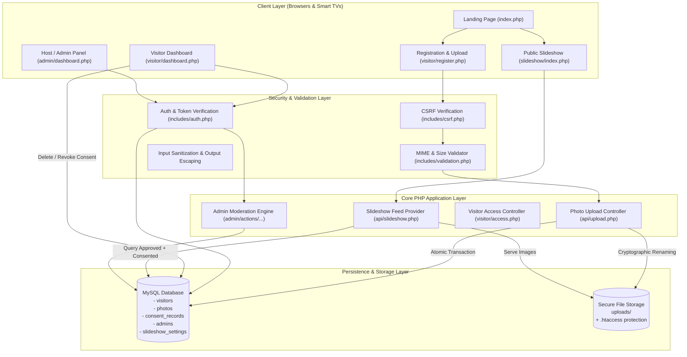
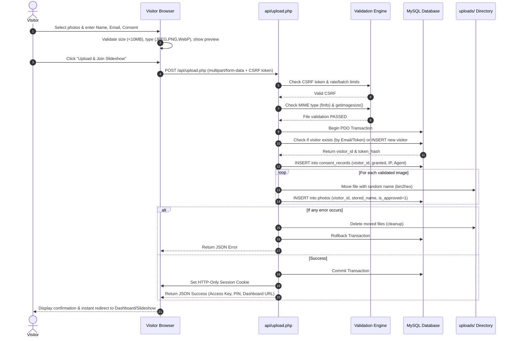

# ARCHITECTURE.md
## Visitor Photo Slideshow - System Architecture & Design
### MCA Assignment 1: Programming and Debugging Using LLMs

---

### 1. Technology Stack & Architectural Rationale

| Component | Choice | Architectural Rationale |
| :--- | :--- | :--- |
| **Backend** | Core PHP 8.2+ | Meets assignment mandate (no frameworks). Lightweight, high performance, native session handling, and direct procedural/modular control. |
| **Database** | MySQL / MariaDB | Relational integrity, ACID transaction support, foreign key cascades, and high concurrency handling with prepared statements. |
| **DB Layer** | PHP Data Objects (PDO) | Secure parameterized queries (SQL injection immunity), transaction management, and portability. |
| **Frontend** | HTML5, CSS3, Bootstrap 5, Vanilla JS | Rapid responsive UI creation, mobile-first design, zero heavy build steps (no npm/bundler runtime overhead), and standard fetch API. |
| **Display** | Smart TV / Projector Compatible CSS/JS | Fullscreen API, auto-cycling crossfade slideshow, keyboard accessibility, high contrast, clean typography. |
| **Security** | SHA-256 tokens, bcrypt PINs, CSRF tokens, MIME detection | Defense-in-depth across authentication, session management, and media ingestion. |

---

### 2. High-Level System Architecture Diagram

---

### 3. Detailed Request Flows

#### 3.1 Visitor Registration & Upload Flow

---

### 4. Returning Visitor Identification Architecture

1. **Initial Registration:**
   - Visitor provides Name, Email, and optional 6-digit PIN.
   - Server creates a 64-char random token `bin2hex(random_bytes(32))`.
   - `token_hash = hash('sha256', $token)` is saved in the `visitors` table.
   - Plaintext `$token` is sent back once in session cookie and displayed as a private access link:
     `http://localhost/visitor-photo-slideshow/visitor/access.php?key=TOKEN`
2. **Subsequent Access Methods:**
   - **Method A (Active Session):** The visitor returns on the same browser; session cookie auto-authenticates.
   - **Method B (Magic Access Link):** The visitor clicks their saved access link with `?key=...`. The server hashes the provided key and matches it against `token_hash`.
   - **Method C (Credential Login):** The visitor provides their **Email + 6-digit PIN** on the visitor access page (`/visitor/access.php`).
3. **Session Security:**
   - Session cookies use `HttpOnly`, `SameSite=Lax`, and `Secure` (when HTTPS is available).
   - Session fixation protection: `session_regenerate_id(true)` is called upon login.

---

### 5. Public Slideshow Engine Architecture

1. **TV-Optimized Presentation:**
   - Full viewport canvas with dark blur ambient background for vertical or irregular aspect-ratio photos.
   - Smooth 800ms CSS cross-fade transition between slides.
   - High-contrast HUD displaying slide progress, auto-play indicator, pause/resume toggle, and visitor attribution name (if consented).
2. **Asynchronous Polling & Dynamic Updates:**
   - The frontend slideshow engine periodically polls `/api/slideshow.php` (every 25 seconds) using `fetch('../api/slideshow.php', { cache: 'no-store' })`.
   - The endpoint queries the database for all currently approved photos belonging to visitors with active consent (`is_approved = 1 AND consent_status = 'granted'`) and returns the complete, current playlist in JSON format.
   - Upon receiving the updated playlist, `assets/js/slideshow.js` dynamically syncs its local queue:
     - If the queue was empty, it hides the empty state, immediately displays the first photo, and starts the automatic rotation timer.
     - If the slideshow is already running, it updates the total slide counter and preserves the currently displayed slide without resetting or interrupting the viewer's playback.
     - If newly approved photos have arrived, they are seamlessly integrated into future rotation cycles.
     - If a photo was unapproved or deleted, or if a visitor withdrew consent, the photo is automatically omitted from the queue on the next polling cycle, smoothly advancing or falling back to a valid slide.
     - If all photos become unapproved or removed, the slideshow transitions back to the empty state and halts rotation timers.

---

### 6. Concurrency & Atomicity Strategy

To handle simultaneous uploads from many event attendees:
1. **Zero Collision Guarantee:** Every file receives an independent 128-bit random token name:
   `$stored_name = bin2hex(random_bytes(16)) . '.' . $extension;`
2. **ACID Transactions:** Every upload batch wraps all SQL operations in a single PDO transaction.
3. **Rollback Guard:** An array of written file paths is tracked in memory during upload. If an unhandled exception or database failure occurs, an explicit `unlink()` loop purges the written files before returning an HTTP 500 error, guaranteeing no orphaned disk files.

---

### 7. Security Model & Defense in Depth

1. **SQL Injection Protection:** 100% prepared statements across all PDO queries with bound parameters. Zero dynamic SQL string concatenation.
2. **Cross-Site Scripting (XSS) Prevention:** All output rendered to HTML passes through `htmlspecialchars($str, ENT_QUOTES | ENT_SUBSTITUTE, 'UTF-8')`.
3. **Cross-Site Request Forgery (CSRF):** Synchronizer Token Pattern implemented with secure session tokens validated on all state-altering POST requests.
4. **File Execution Hardening:** The `uploads/` directory contains an Apache configuration that strictly forces default handler and disables PHP script execution.
5. **Admin Access Control:** Protected via `password_hash()` (bcrypt / argon2id) with strict session authentication checks on every administrative route.
